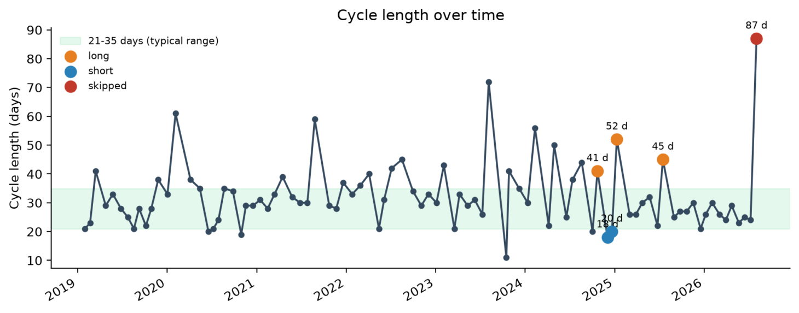

# Your Menohelp Cycle Report
## Summary
Your cycle pattern shows clear irregularity. The average cycle length is still inside the usual 21 to 35 days, but the recent average is not, and the swings between cycles are much larger than usual. Your blood results fit this picture. Your AMH is very low for your age, and your symptoms are strongest around the cycle and breasts, with heavy PMS and mood swings standing out most. This is a pattern worth discussing with a gynaecologist, especially because the changes are early for your age.

## What we found

### Your cycle

Your average cycle length is 32.1 days, so it sits inside the usual 21 to 35 days. Your recent average is 35.3 days, so that falls outside the usual range. Your variation is 11.7 days, which is much more than typical. Your recent variation is 25.4 days, which shows the swings have grown. You also have 39 jumps of 7 days or more between consecutive cycles.

This can point to a cycle that is becoming less steady. It often happens when ovulation is less predictable and progesterone is less consistent from cycle to cycle.

### Your blood results
- Your AMH (anti-Müllerian hormone) of 0.39 ng/ml is very low for age 30. At age 30, most healthy women have around 3.54; your value is typical for women around 46. This can point to a lower egg reserve than usual for your age. That would fit with the cycle irregularity and makes an early change a real possibility to discuss with a gynaecologist.
- Your haemoglobin of 11.5 g/dl is below the usual range. This can go with low iron or anaemia, especially when cycles are heavy or prolonged. It can add to tiredness, low mood and palpitations.

Also outside the lab's range: LH 2.33 mIU/ml (below the lab's range) and prolactin 3.26 ng/ml (below the lab's range). On their own, these do not change the picture.

In range: ferritin, oestradiol (E2), progesterone, testosterone, SHBG, DHEA-S, FSH, TSH, free T3, free T4, androstenedione and TPO antibodies.

### Your symptoms
You logged symptoms in 9 body systems, with 2 marked strong and 1 moderate. The strongest areas are breasts and cycle and reproduction, and your own words were “Heavy PMS symptoms and mood swings and sadness.” That combination gives a strong symptom load, with skin symptoms also standing out.

## Conclusion

### What it could mean
Your cycle changes can point to an early shift in ovarian activity. Long cycles, skipped cycles and many jumps between cycles fit the kind of irregularity often seen when ovulation becomes less reliable and progesterone output becomes less steady. In someone under 40, this would be early and should be checked by a gynaecologist.

Your AMH makes that picture stronger. It is very low for your age, and that matches the idea of a lower egg reserve. Your FSH is still within the usual range, so one normal FSH does not remove this concern.

Your symptoms also fit a hormone swing picture. Strong PMS, mood changes, breast symptoms, sleep issues and skin changes can go with too little progesterone in the second half of the cycle or with a relative oestrogen/progesterone imbalance. Your LH is below the lab range and your prolactin is below the lab range, but your thyroid results are in range, so thyroid trouble is less likely to explain the whole picture.

Low haemoglobin may also be part of the story. If bleeding is heavy, iron loss can build up over time and make fatigue, low mood and palpitations worse.

### Talking to your doctor
- Ask a gynaecologist to look at the cycle changes, the skipped cycles, and the 39 jumps between consecutive cycles.
- Ask whether your low AMH at age 30 fits an early change in ovarian reserve and whether early menopause or premature ovarian insufficiency should be considered.
- Ask about the heavy PMS, mood swings, sadness, and breast symptoms.
- Ask whether progesterone in the second half of the cycle should be checked.
- Ask your GP about the low haemoglobin and whether iron studies, including ferritin, should be reviewed in the context of your bleeding.

### Things that may help
- Keeping a simple cycle and symptom diary can help you and your doctor see whether the long cycles, skipped cycles and PMS cluster together.
- If heavy bleeding is part of your cycle, iron-rich food and follow-up of low haemoglobin can help support your energy.
- For heavy PMS, mood swings and sadness, regular sleep, steady meal times and stress-reducing routines can help some people feel more stable.
- For breast pain or tenderness, a look at cycle timing and symptom tracking can help spot whether it follows the second half of the cycle.
- If vaginal dryness or other skin and mucous symptoms become more troublesome, you can discuss symptom relief options with your doctor.

**Worth acting on soon**
- Very heavy, painful or disrupted bleeding that you rate as strong is worth discussing with a doctor soon.
- Your cycle pattern, your symptoms and your blood results point in the same direction, and at your age that would be early. Please ask a gynaecologist to look at them together soon; this is a pattern worth checking, not a diagnosis.

---
**How to read this report**
- A single blood value is a snapshot: hormone levels change from day to day and from cycle to cycle.
- Timing of your blood tests: 2022-11-10 (no cycle day given) and 2025-04-03 (cycle day 7). These values are best read from a draw at a set point in the cycle: FSH, LH, SHBG, androstenedione, oestradiol (E2) and testosterone on cycle day 2 to 5; progesterone about a week after ovulation.
- Age comparisons for AMH use data from healthy women (Ji et al. 2022). Labs use different tests, so treat the comparison as a guide.
- This report describes patterns in your data. It is not a diagnosis; only a doctor can tell what is behind them.

---
*This report is generated from your logged cycle data for information only. It is not medical advice and is not a diagnosis. Please talk to a doctor or other qualified health professional about any concerns.*
